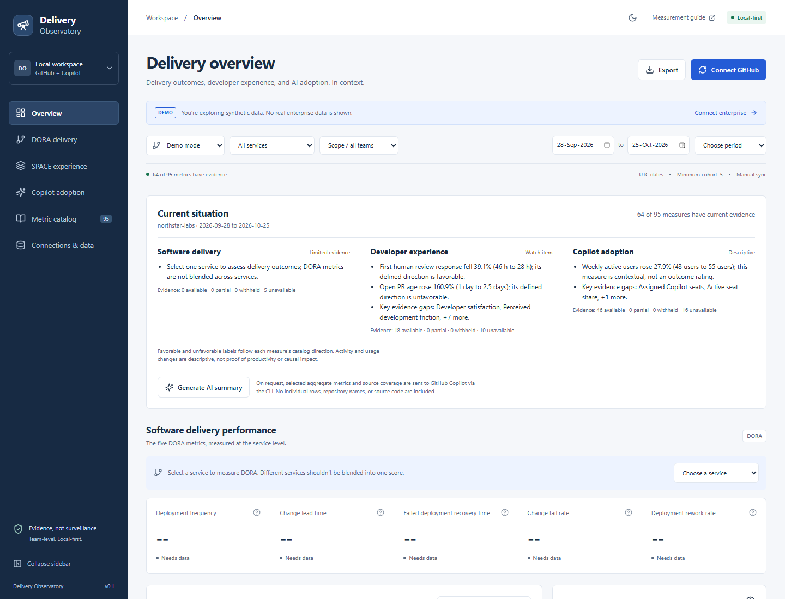

# GitHub Engineering Insights

GitHub Engineering Insights is a local-first dashboard for **DORA delivery outcomes**, **SPACE developer experience**, and **GitHub Copilot adoption and usage**. Built with React, TypeScript, Node, and SQLite. No cloud services or remote repository are required for the dashboard; optional AI summaries use the locally installed GitHub Copilot CLI.

[](../../actions/workflows/ci.yml) [](LICENSE)



*Screenshot: synthetic Demo data only. Names and figures are illustrative, not a real enterprise's results.*

## What this project does

| View | What you learn | Important boundary |
| --- | --- | --- |
| Delivery overview | Current situation across delivery, experience, and Copilot engagement | Separate domains, not a composite productivity score |
| DORA delivery | Deployment frequency, change lead time, recovery, failure and rework | Select one mapped production service |
| SPACE experience | Satisfaction, performance, activity, collaboration and flow | Some measures require imported survey or incident evidence |
| Copilot adoption | Adoption, feature use, completions, and agent activity | Usage is not proof of productivity, ROI, or causality |
| Metric catalog | Definitions, formulas, provenance and caveats for 95 measures | Catalog inclusion does not guarantee available live evidence |
| Connections & data | One enterprise, manual sync, imports, source status and removal | Local single-user operation, not a hosted monitoring service |

**Publishing source code is different from publishing enterprise data.** This repository is intended to be shared as a local app; it is not ready to expose as an internet-facing service. Keep databases, exports, credentials, and real-enterprise screenshots out of public commits. See [Security and publication](SECURITY.md), [Architecture](docs/architecture.md), [Troubleshooting](docs/troubleshooting.md), and [Contributing](CONTRIBUTING.md).

## Run

Requires **Node.js 24+** and npm. **GitHub CLI (`gh`)** is needed only for live connections; **GitHub Copilot CLI (`copilot`)** is needed only for optional AI summaries. Demo mode requires neither sign-in nor access to an enterprise.

```powershell
git clone https://github.com/<owner>/github-engineering-insights.git
cd github-engineering-insights
npm ci
npm run build
npm start
```

Open **http://127.0.0.1:4317**. To use a different port:

```powershell
$env:PORT = "4319"; npm start
```

Keep the terminal running while using the app; press **Ctrl+C** to stop it. `npm run dev` runs the same local API with Vite hot reload; `npm start` serves the built UI. `npm run check` runs type checking, synthetic tests, and a production build.

After changing server code, stop and restart `npm run dev`: Vite hot reload updates the browser UI, not the Express server process. For `npm start`, rebuild first. Reload the browser after any server restart to obtain a fresh local session token. The telescope favicon is served from `/favicon.svg` in both modes.

### Quick analysis

The Delivery overview summarizes DORA, SPACE, and Copilot evidence separately. Each framework page adds a focused readout based on the selected scope, service/team filters, date window, and comparable prior window. It calls out favorable or unfavorable movement only when the metric catalog defines a direction; usage/activity movements remain descriptive. Partial, suppressed, and unavailable measures are identified as coverage limits, not turned into zeroes. These summaries are deterministic by default and are not productivity scores or causal impact claims.

### Optional Copilot CLI summaries

Install and sign in to GitHub Copilot CLI separately from `gh`:

```powershell
copilot login
```

Each analysis panel has a **Generate AI summary** action. Nothing is sent until you click it. The app sends only the selected date window, selected-filter indicators, metric definitions and privacy-filtered aggregate current/prior values, coverage counts, and source-family states. It omits enterprise, service, team, and repository names; user identifiers, individual rows, sample/denominator counts, daily series, raw events, source code, and credentials are not included. Suppressed or unavailable values are never sent as numbers.

Select your data mode and filters, open Overview, DORA, SPACE, or Copilot, then click **Generate AI summary**. The result appears below the deterministic analysis. A server-side request using synthetic Demo aggregates successfully generated a summary during the 2026-10-26 integration check; this verifies the local CLI/API path, not live enterprise metric accuracy or the correctness of every generated claim.

The CLI invocation requests an empty tool allowlist and disables built-in MCP servers, custom instructions, client telemetry, account-history sync, and automatic updates. It runs from a temporary empty directory with a 90-second timeout and a 30-AI-credit session ceiling (the CLI's minimum supported limit, not the expected cost of a summary). This is not an OS sandbox or isolation from global CLI configuration; live enforcement of the empty tool list was not established by the automated tests. Review [the AI security boundaries](SECURITY.md#optional-ai-summaries) before using internal aggregates. The app does not persist the request or generated summary; the CLI may retain its normal local session history. If the CLI is missing, signed out, blocked, or fails, the deterministic summary remains available and the panel shows an error.

For development, `npm run dev` serves the UI and API together on the same loopback origin. The development HMR port is the application port plus one.

The application defaults to **explicitly labeled synthetic demo mode** on a fresh browser profile. Existing valid browser scope/service/team preferences can be restored, with the date window rolled forward. Demo facts are generated independently of the live database and cannot be edited or synced.

## Connect real data

1. Sign in outside the app: `gh auth login --hostname github.com`.
2. Open **Connections & data**, check authentication, and connect your GitHub Enterprise Cloud slug. The app has two modes: **Demo mode** and one connected **Enterprise**; organization connections and multiple simultaneous enterprises are not supported.
3. Enter the exact `owner/repository` names to collect (maximum 20 per scope).
4. Map each production service to one repository and the exact GitHub deployment environment. Additional mappings can be added below the connection form.
5. Select the live scope and press **Sync data**. Source-specific access/coverage is shown independently; one denied source does not disable the others.
6. Select a single service for DORA, or clear the service filter for scope-level Copilot usage. Team selection is available only when evidence and privacy rules permit.

GitHub Enterprise **Cloud on github.com** is supported; GitHub Enterprise Server/custom hosts are not. Enterprise Copilot reports cover the selected enterprise; repository metadata is restricted to the explicit repository list. Nothing changes account permissions, policies, SSO settings, or authentication automatically.

To switch enterprises, open **Connections & data → Connected enterprise → Remove enterprise** and confirm **Remove enterprise and local data**. This atomically removes that connection, its collected facts, imported evidence, source coverage and sync checkpoints from the app's SQLite tables, then returns to Demo mode. GitHub data and saved CLI credentials are unchanged. Finish or cancel an active sync first. You can then connect another enterprise; it starts with no retained data from the removed connection.

If a previous version saved several connections, the app starts in Demo mode and shows **Choose one enterprise** in Connections & data. Select the enterprise to retain and confirm **Keep selected enterprise and remove the others**. Its existing data is preserved; the other connections and their local data are removed atomically. Nothing is automatically deleted during upgrade.

### Source access

| Source | Requirements / limitations |
|---|---|
| Repository metadata | Read access to selected repositories, PRs, reviews, issues, commits, Actions, deployments and statuses. Access depends on the CLI's existing token type and grants. |
| Organization Copilot reports | Organization owner or authorized metrics permission; OAuth/classic PAT reports document `read:org`. Required Copilot usage policy must be enabled. |
| Enterprise Copilot reports | Enterprise owner, billing manager, or authorized enterprise metrics permission; documented OAuth/classic scopes include `read:enterprise` or `manage_billing:copilot`. |
| Seat snapshot | Organization billing seats endpoint and appropriate read access. Enterprise seat snapshots are explicitly unsupported in this version. |
| Team usage | Daily per-user and user-team reports. GitHub omits teams with fewer than five seated users; membership and usage must be joined on the same day. |

Organization endpoints are listed as background API context; the current connection UI supports **enterprise scope only**. Enterprise seat snapshots are not implemented, so seat-based percentages may remain unavailable even when usage reports are Ready.

The UI does not accept tokens. The server invokes `gh api` using argument arrays, with `github.com` explicitly selected. Report files are downloaded without forwarding GitHub credentials. Signed report destinations are bounded to HTTPS GitHub (including the exact `copilot-reports.github.com` report host), Azure Blob, and S3 delivery hosts; unsupported destinations fail visibly instead of being fetched arbitrarily.

GitHub can return HTTP 204, an empty JSON string, or an empty download-link list when a report is unavailable. Sync checks every date even if earlier reports are missing, retains available days, and reports incomplete coverage explicitly. Missing days are not checkpointed as successful, so future syncs retry them. A wholly absent report family is shown as unsupported; some available days with gaps are shown as partial. Neither means a measured zero.

## Measurement behavior

The searchable **Metric catalog** is the inventory and formula reference. Every value links to an explanation with its source, grain, caveats, status, sample, denominator, and reporting window. Metrics may be available, partial, unavailable, or suppressed. Missing or denied evidence is **not** zero.

### DORA

All five current definitions are represented:

- Deployment frequency: distinct successful production deployments per calendar day.
- Change lead time: committed timestamp to first proven production deployment for newly deployed commits.
- Failed deployment recovery time: deployment-linked failure to recorded recovery, not general incident MTTR.
- Change fail rate: distinct production deployments requiring intervention / eligible production deployments.
- Deployment rework rate: distinct explicitly incident-driven unplanned deployments / eligible production deployments.

DORA requires **one selected service**. The first observed deployment is a baseline, not evidence of which changes were newly delivered. GitHub comparison metadata establishes ancestry between successful deployments. Merge/squash semantics follow the actual deployed commits, not PR creation time. Divergent/rollback ancestry produces a visible coverage gap. Successful workflow runs and releases are never silently treated as production deployments.

Duration cards use underlying-sample medians and expose p90 where calculable. Duration charts use **daily medians**; the overall median is not derived from those daily medians. Deployment rate charts include zero-deployment days only when the source was observed.

Incident observation coverage is required to distinguish an observed zero failure rate from missing incident data. Recovery excludes unresolved incidents and marks the result partial. Rates use distinct deployment IDs, not incident counts. For retrospective rate windows, later imported incident links can revise earlier deployment cohorts.

### SPACE

SPACE is a framework, not an exhaustive standardized metric checklist. This app provides curated measures across Satisfaction, Performance, Activity, Communication/collaboration, and Efficiency/flow. Activity counts include bot and human repository activity unless the definition explicitly says human; review response/coverage excludes bots and author self-reviews.

Surveys are **pre-aggregated team data**, never respondent-level records. They provide satisfaction, friction, sustainable workload, Copilot usefulness, and an optional declared quality outcome. No sentiment, focus hours, working hours, or well-being is inferred from GitHub activity.

Ready-to-review duration, cross-team review participation, and actual CI execution duration are cataloged but explicitly unavailable until their timeline, historical membership, or job-completion evidence is implemented. The app does not substitute PR creation, current membership, or run `updated_at`.

### Copilot

Current daily report-download APIs are used for organization/enterprise aggregates, users, user-teams, and repositories. The latest 28-day aggregate report supplies exact-window feature engagement; its daily totals are not ingested a second time. Repository reports are filtered to the configured repository list.

The catalog includes seat snapshots, daily/weekly/monthly actives, completion acceptance, interactions, generation/acceptance events, editor line changes, feature/editor/language/model breakdowns, agent-authored/reviewed PRs, review suggestions, CLI/App/VS Code agent usage, tokens, credits, adoption cohorts, and supported customization breakdowns. Availability varies by the returned schema; unsupported optional fields are shown as missing, not invented.

Unique-user counters use the **latest applicable source value**, not sums across days. Daily usage is joined to **daily** team membership before aggregation. Team totals overlap and must not be summed. Current seats are not used as a historical adoption denominator. A reported daily median is shown as the latest daily median, not averaged into an overall median.

Copilot IDE telemetry cannot be assigned to repositories. With a service selected, only supported repository-level Copilot PR measures can be shown. Editor lines are not production lines shipped; tokens and AI credits are consumption, not invoices; cohort comparisons are not causal impact or ROI.

## CSV evidence

Download empty templates from **Connections & data**. Files must be UTF-8 CSV, at most 2 MB / 10,000 rows, with the exact headers. Preview shows row errors; commit is atomic. Corrections replace the same stable identity. Repeated file imports do not duplicate facts.

### Survey aggregates

```csv
team,from,to,question,min,max,responses,score,eligible
checkout-team,2026-10-01,2026-10-18,satisfaction,1,5,20,4.2,25
```

Questions: `satisfaction`, `friction`, `sustainability`, `copilot-usefulness`, `quality-outcome`. `eligible` is optional/blank. Scales must be consistent; score must be within min/max; responses cannot exceed eligible population. Overlapping periods for the same team and question are rejected. Only aggregates fully contained in the selected window are included. Multiple teams are not silently blended. Response rate requires one consistent cohort and period.

Unknown columns, including identities and free text, are rejected. Fewer than five responses are persisted for correction but their metric values, samples, and trends are withheld.

### Incidents and observation coverage

```csv
record_type,service,incident_id,failed_at,recovered_at,failed_deployments,rework_deployments,from,to
coverage,checkout,,,,,,2026-10-01,2026-10-18
incident,checkout,inc-100,2026-10-09T10:00:00Z,2026-10-09T11:00:00Z,checkout:my-org/api:123,checkout:my-org/api:124,,
```

`service` must match the configured stable service ID. Use exact deployment IDs from the **production evidence** link in the import screen. Separate multiple failed/rework deployment IDs with semicolons. All links must refer to synced successful production evidence for the same service. Leave recovery blank for unresolved incidents. Coverage rows explicitly attest the complete observed period, including zero-incident periods; they are not inferred from the presence of a CSV file.

## Local persistence and privacy

- Private state is in **`.local\metrics.sqlite`** (plus SQLite WAL files) and is ignored by Git. Treat the folder as sensitive internal metadata and protect it with your operating-system account/file permissions.
- The app retains stable user IDs only on the server where needed for unique counts and daily joins. Usernames, source code, patches, issue/PR bodies, prompts, survey identities, signed URLs, and credentials are not persisted.
- Manual sync initially covers 90 days of GitHub metadata and 28 days of Copilot reports. Recent daily checkpoints are refreshed for corrections; other completed days can be resumed. Detailed facts outside retention are pruned on sync. Open PR/issue baseline metadata and aggregate surveys/observation declarations are retained as needed.
- People-based displays/exports suppress cohorts below five. Team filters are conservatively withheld when small complements, overlapping differences, or observed daily membership changes could reveal a small cohort. This is a disclosure-control measure, **not a formal differential-privacy guarantee**; data should remain internal.
- A source marked **Ready** means its reports were collected successfully, not that its values meet display requirements. If every daily Copilot active-user cohort is below five, the dashboard shows a privacy explanation instead of usage values or charts. Re-syncing does not bypass suppression.
- **Small-enterprise opt-in (off by default):** under **Connections & data → Small-enterprise privacy setting**, acknowledge the disclosure risk and choose **Allow small-cohort enterprise aggregates**. Existing enterprise-wide Copilot values, charts, breakdowns and exports are recalculated without another sync. Very small enterprises may effectively expose an individual's activity; do not treat these exports as anonymous or enable this in a shared hosted deployment. No individual rows or rankings are exposed. Team, service, survey and reviewer protections are unchanged. **Restore five-person protection** disables the exception immediately. The setting is stored only with this local enterprise and removed with it.
- The server binds only to `127.0.0.1`, rejects unexpected Host/Origin values and cross-site API requests, and requires a local CSRF token for mutations. No permissive CORS or hosted analytics is configured.
- Exports contain filtered metric results/definitions, not raw user rows. CSV cells are protected from formula injection.
- No scheduled sync, webhook, cloud storage, remote push, or multi-user login is created. AI summary generation is opt-in and sends the explicitly described aggregate snapshot to GitHub Copilot.

### Companion canvas status

This repository delivers a **web application**, not an installable Copilot canvas extension. You can preview the local URL inside a browser canvas, but no registered project-scoped extension is included.

An installable extension would require the supported canvas SDK, registration, lifecycle handling, and end-to-end validation. The shared metric/data layers are reusable, but that integration is future work.

## Public-release limitations

The supported deployment is **one trusted user on their own machine**. There is no multi-user authentication, role-based access control, TLS termination, encrypted database, or tenant isolation. Do not forward its port, bind it to a public interface, or publish live-data exports as a public dashboard.

GitHub Enterprise Server, custom/data-residency hosts for ingestion, Azure DevOps ingestion, automatic sync, and a registered canvas extension are not implemented. GitHub API access and schema availability depend on your account, enterprise policy, and reporting windows. AI generation also depends on a compatible installed Copilot CLI and account policy; the test suite uses a fake generator rather than spending credits or establishing live inference correctness.

## License

Released under the [MIT License](LICENSE). Dependencies retain their own licenses. See also the [Code of conduct](CODE_OF_CONDUCT.md).

## Development checks

```powershell
npm run typecheck
npm test
npm run build
```

Tests use synthetic fixtures and in-memory SQLite; no organization access or real secrets are required. Live source acceptance requires a user-configured scope with actual permissions; a demo or permission denial cannot establish live metric correctness.

Primary references: [DORA](https://dora.dev/guides/dora-metrics/), [SPACE paper](https://queue.acm.org/detail.cfm?id=3454124), [Copilot fields](https://docs.github.com/en/copilot/reference/copilot-usage-metrics/copilot-usage-metrics), [report APIs](https://docs.github.com/en/rest/copilot/copilot-usage-metrics), [team attribution](https://docs.github.com/en/copilot/reference/copilot-usage-metrics/team-level-metrics).
