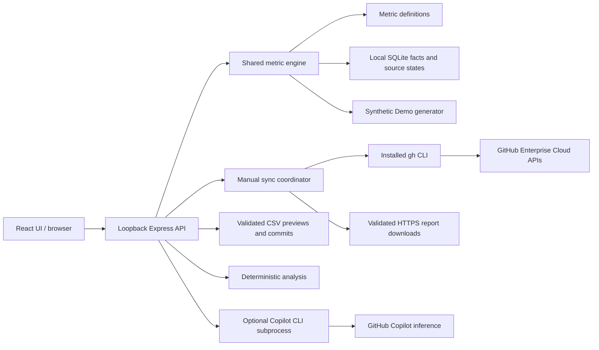

# Architecture and data flow

GitHub Engineering Insights runs entirely as a loopback web app except for deliberate GitHub API syncs and optional Copilot inference. The browser does not receive credentials or raw per-user report rows.

## Source map

| Path | Responsibility |
| --- | --- |
| `apps/web/main.tsx` | Navigation, filters, charts, metric explanations, analysis panels, connection/import UI |
| `apps/web/api.ts` | Same-origin API requests and local session CSRF header |
| `apps/web/style.css` | Dashboard layout, tokens, responsive styling and themes |
| `apps/server/index.ts` | Loopback startup, SQLite location, Vite or built asset serving |
| `apps/server/app.ts` | API validation, local Host/Origin/CSRF boundary, scope selection, exports |
| `apps/server/github.ts` | GitHub CLI calls, report normalization, pagination, sync/cancellation |
| `apps/server/imports.ts` | Incident/survey CSV parsing, validation, preview fingerprint and commit data |
| `apps/server/copilot-summary.ts` | Aggregate-only AI payload and bounded Copilot CLI invocation |
| `packages/data/store.ts` | SQLite tables, transactions, scope deletion, checkpoints and retention |
| `packages/metrics/types.ts` | Dashboard, metric, fact, scope and filter contracts |
| `packages/metrics/catalog.ts` | Definitions, formulas, units, directions, caveats and availability inventory |
| `packages/metrics/engine.ts` | Metric computation, comparable periods and privacy filtering |
| `packages/metrics/analysis.ts` | Rule-based summaries using selected headline measures and catalog directions |
| `packages/metrics/demo.ts` | Synthetic evidence independent of the live database |
| `tests` | Synthetic calculation, API, import, privacy, report and summary tests |

## How a dashboard is calculated

The API validates the scope, date window, and compatible service/team filters. It selects either generated Demo facts or that enterprise's local facts. The engine computes results using catalog definitions and applies disclosure controls before returning a dashboard.

Each metric carries its status, value, prior-window value, reason, observation window, and supporting metadata where permitted. `measured` means available evidence; `partial` means incomplete evidence; `unavailable` means the required source or mapping is absent; `suppressed` means privacy rules withheld it. A source marked Ready is not a guarantee that every downstream metric is available.

DORA requires one mapped production service and proven deployments. Survey measurements require valid aggregate imports. Copilot counts depend on the schema and scope that GitHub actually returns. The engine does not infer that a successful CI run was a production delivery.

## Sync and persistence

Sync is manual and records source outcomes independently. Successful daily report checkpoints support resumable work; unavailable report days are retried instead of checkpointed as measured zeros. Cancellation preserves completed work.

SQLite uses tables for settings, normalized facts, source states, sync checkpoints, and migration metadata. Data lives at `.local\metrics.sqlite`, including WAL sidecars. Removing an enterprise deletes its app records transactionally; this is logical deletion, not a guarantee of forensic erasure from SQLite pages, backups, or the underlying disk.

CSV imports first return a validation preview. Committing requires the fingerprint of that exact preview and commits atomically. Survey rows remain aggregates, not responses by named people.

## Two kinds of summaries

Deterministic summaries run without external inference. They select meaningful headline measures, interpret movement only according to the catalog's direction, and state evidence gaps. Usage remains descriptive.

Optional AI summaries are explicitly requested per panel. The server recomputes selected evidence and creates a minimized payload without enterprise/service/team/repository names, raw rows, daily series, or sample counts. It invokes the installed Copilot CLI, not `gh copilot`, from an empty temporary working directory with a zero-tool allowlist. The rule-based summary remains visible if generation fails.

Standard output supplies the summary; standard error is bounded separately and used only to classify recognized failures into safe messages. The request has a 90-second timeout and a 30-AI-credit session ceiling, the installed CLI's minimum supported limit. A synthetic Demo API request was verified successfully on 2026-10-26. Automated tests mock the subprocess or generator and do not require inference credentials.

The CLI still operates under the local operating-system user and its own configuration/authentication. Its local history and GitHub inference policy are outside the app's SQLite lifecycle. See [Security](../SECURITY.md) for boundaries.

## Extending a metric

Add or update its typed catalog definition, normalize required evidence in the connector/import layer, implement the calculation using underlying samples, and add fixtures for normal, missing, partial, and suppressed cases. Verify the explanation, export, charts and summary behavior agree. Do not mark a measure supported merely because its name appears in the catalog.
